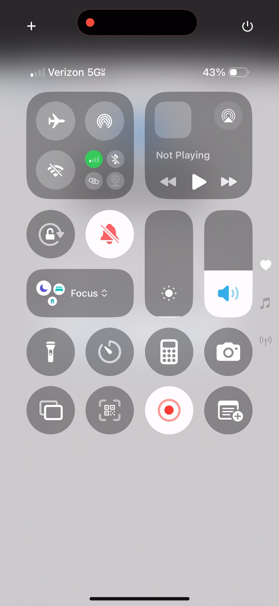

## These screenshots illustrate the screen brightness status when the screen recording begins, and the unexplained decreased that became evident when the control center was swiped down, and unexplained decreased that was happening as the Control Center had already been swiped down into view

### Control Center Screen Brightness Starts 20 Percent: timestamp 00:00:00.000

### Control Center Screen Brightness Decreased Unexplained 1 of 4: timestamp 00:02:09.858

### Control Center Screen Brightness Decreased Unexplained 2 of 4: timestamp 00:02:09.891

### Control Center Screen Brightness Decreased Unexplained 3 of 4: timestamp 00:02:09.924

### Control Center Screen Brightness Decreased Unexplained 4 of 4: timestamp 00:02:09.957

