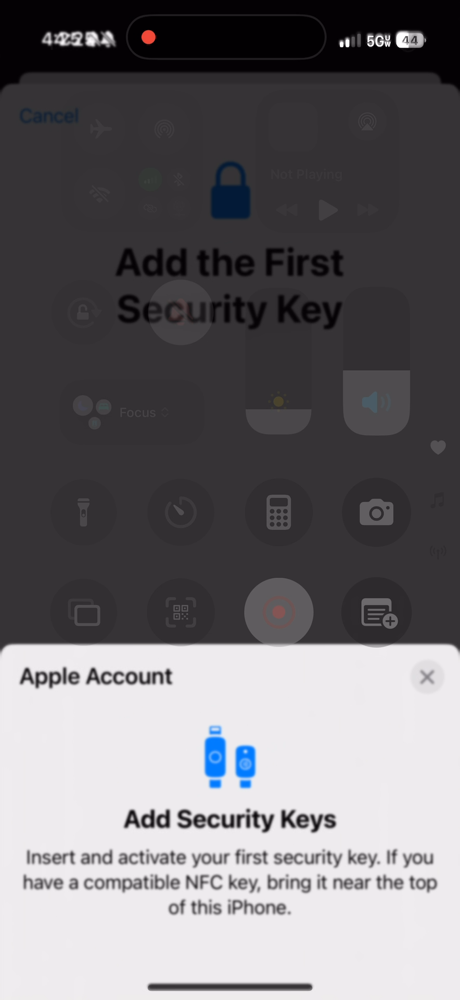
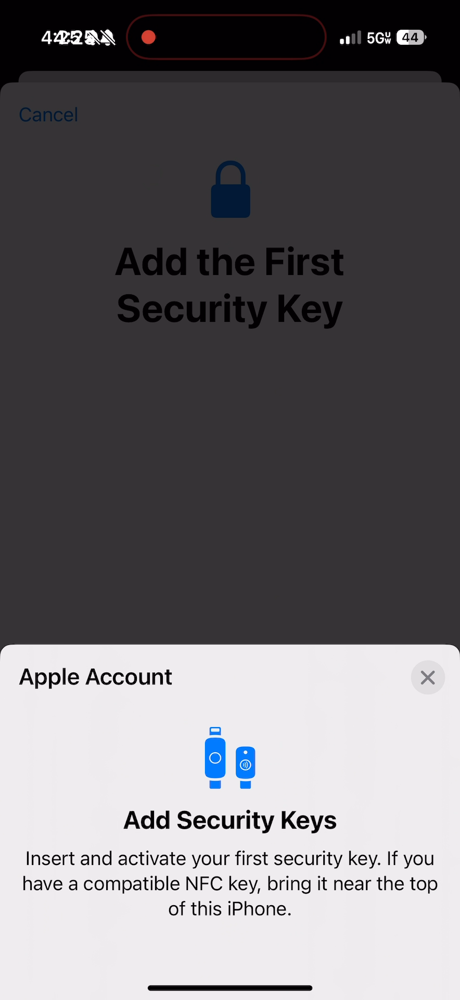
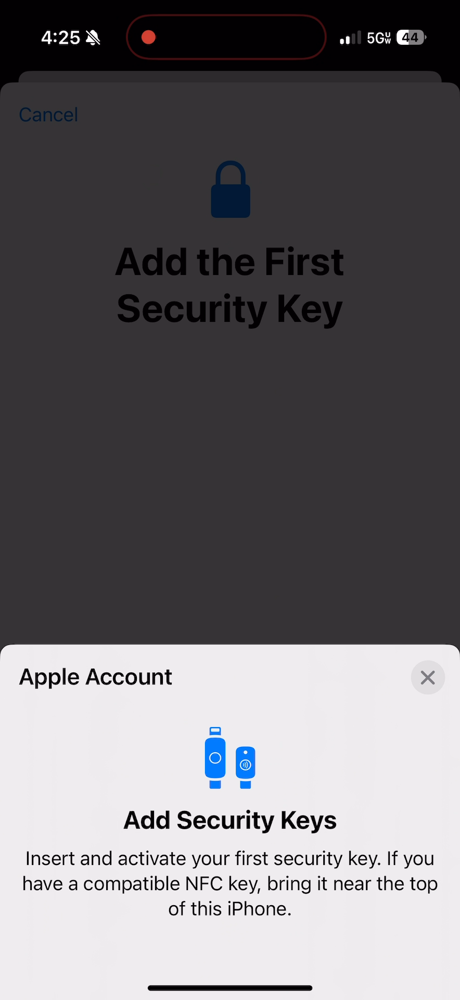

## These screenshots illustrate the garbled system time and silent phone icon of the status bar which appeared garbled after the Control Center was swiped up out of view.

### Status Bar Left Side Garbled Start: timestamp 00:00:01.351

### Status Bar Left Side Garbled Control Center Faded Out: timestamp 00:00:01.550

### Status Bar Left Side Garbled Last Frame: timestamp 00:00:01.912

### Status Bar Left Side Ungarbled First Frame: timestamp 00:00:01.945

