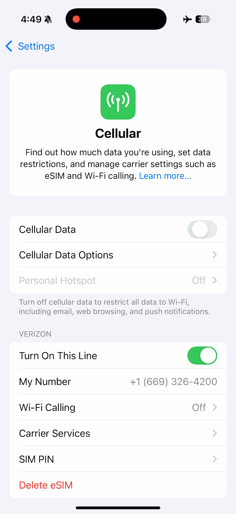
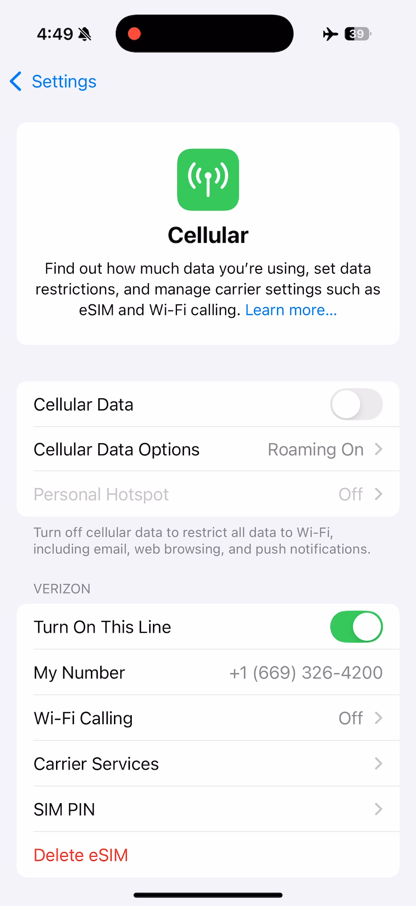

## Anomalous Cellular Data Toggle Behavior and Unexpected Roaming Status Update

**Combined Anomalous Behavior**

Considered together, these two events constitute an anomalous sequence of interface behavior:

The "Cellular Data" toggle exhibits a brief, rightward movement suggestive of an attempted activation, but subsequently returns to its original Off position without retaining the On state.
Almost simultaneously, the "Cellular Data Options" status changes from blank to "Roaming On."

The juxtaposition of these events is noteworthy because the Cellular Data control visually returns to its original Off state, while the associated options menu independently displays a newly established "Roaming On" status.

This creates an apparent inconsistency between the displayed state of the primary Cellular Data control and the accompanying roaming-status information. The observed behavior warrants further examination to determine whether it reflects an interface-rendering anomaly, an asynchronous configuration-state update, or another underlying system behavior.

### [00:05:58.010] Cellular Data – Transient Toggle Movement Without a Persistent State Change

The "Cellular Data" toggle switch exhibits an anomalous, transient movement toward the right, visually resembling an attempt to transition from the Off position to the On position. However, the switch does not complete or retain this state transition. Instead, it subsequently returns to its original left-hand position, indicating that Cellular Data remains visually configured as Off.

### [00:05:58.043] Cellular Data Options – Unexpected Status Change

At timestamp 00:05:58.043, the "Cellular Data Options" menu item undergoes a separate, observable change in its displayed status. Previously blank, the status field updates to display "Roaming On."

