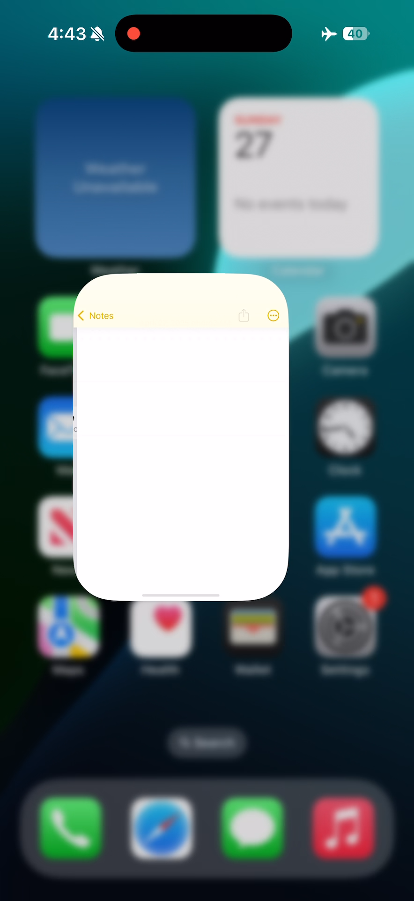

### The Notes App was tapped opened, and the container of the app was missing its own status bar (timestamp 00:00:08.704), which is inconsistent with the behavior of other apps. Examples included. 

**FILENAME:** "Capture_2025-04-27_04-43-45_New iPhone 16 Pro Hacked During Verizon Instore eSIM Activation_ScreenRecording_04-27-2025 04-43-44_1.MP4_00-00-08_704 - Notes App Opening Missing Own Status Bar.png"

