## Status Bar Inconsistencies During App Launch

At timestamp 00:00:08.737, the Notes app opens without displaying its own status bar. Across the examined screen recordings, however, inconsistent behavior is observed: some applications display two status bars, while others rely exclusively on the system-level status bar. More notably, the Notes app appears with its own status bar in other recordings, raising the question of why it is absent in this particular instance. The screenshots below document these variations and provide examples for comparison.

### Settings App Opening Two Status Bars: timestamp 00:03:40.136
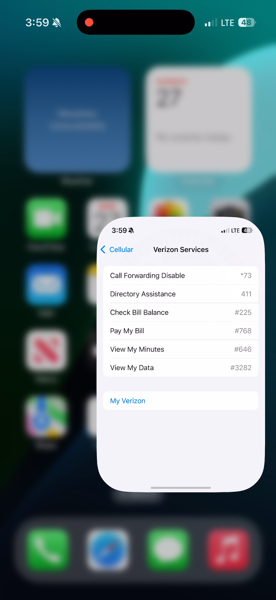

### Notes App Opening Missing Own Status Bar: timestamp 00:00:08.704
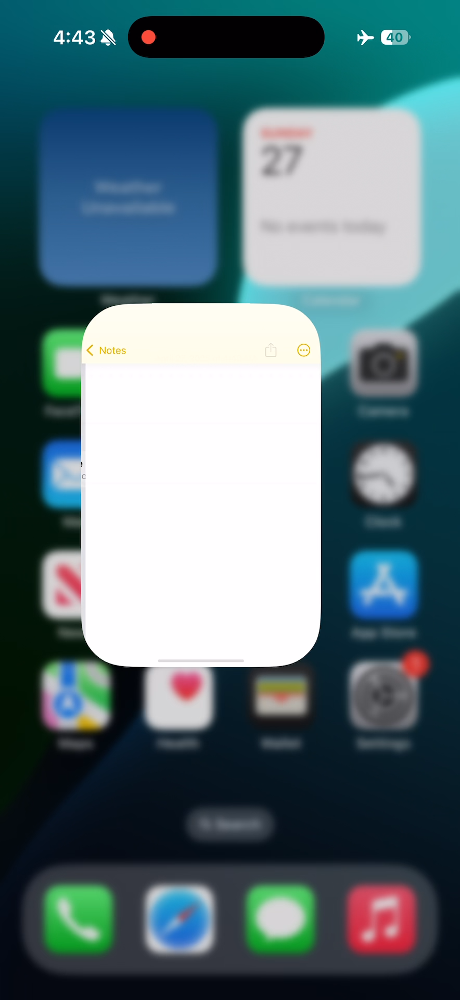

### FRAME 530: timestamp 00:00:08.851
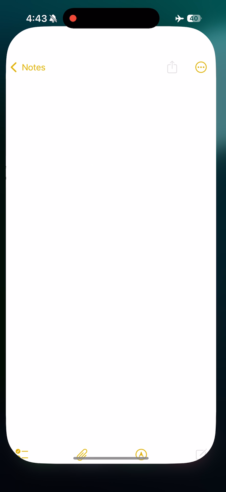

### FRAME 536: timestamp 00:00:08.950
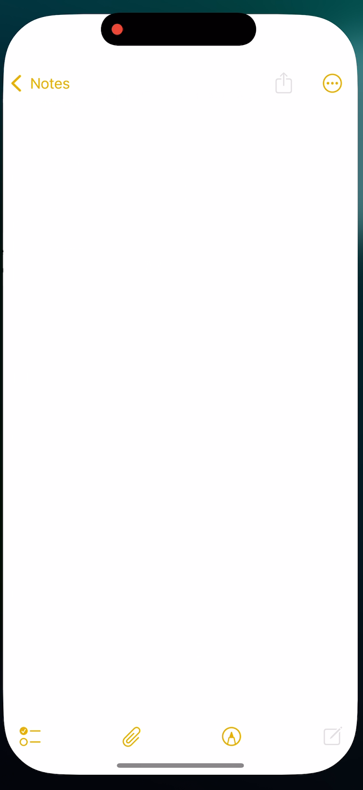

### FRAME 542: timestamp 00:00:09.049
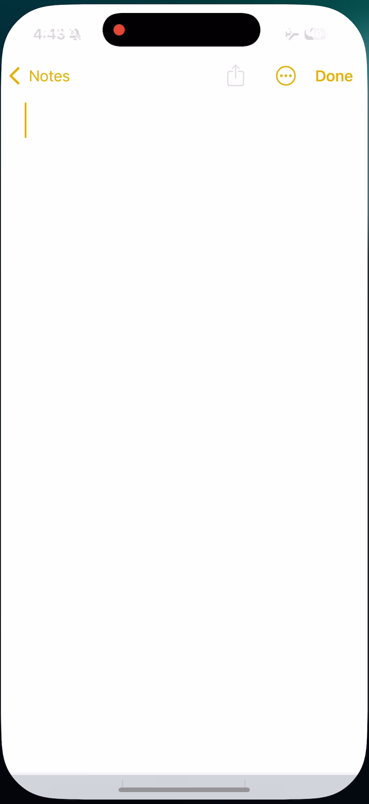

### FRAME 544: timestamp 00:00:09.082
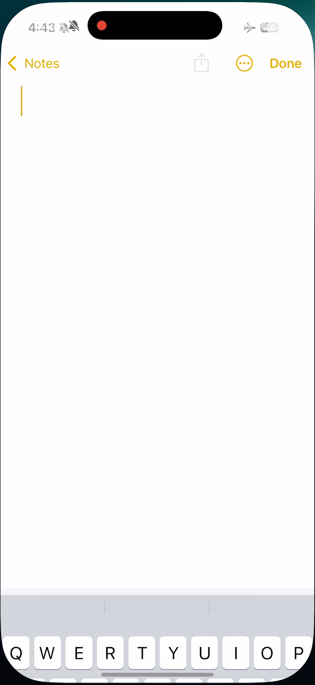

### FRAME 546: timestamp 00:00:09.115
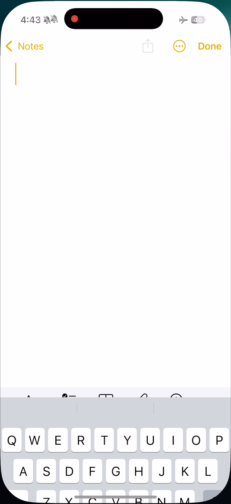

### FRAME 556: timestamp 00:00:09.280
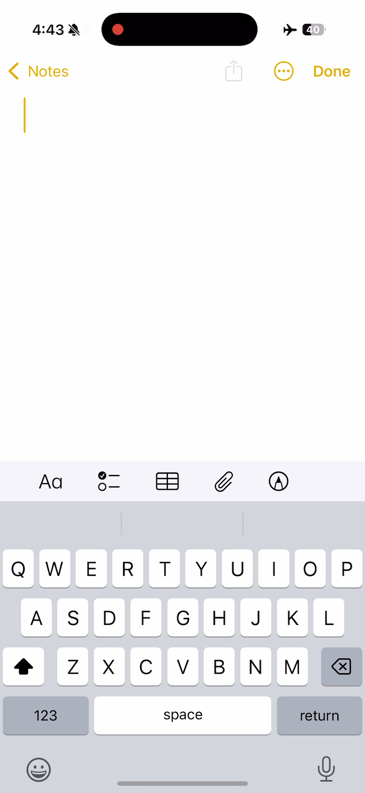

### Safari App Opening Two Status Bars: timestamp 00:00:38.978
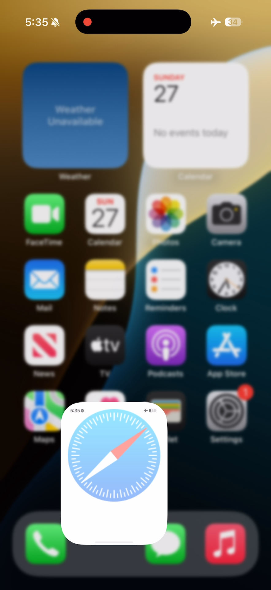

### Settings App Opening Two Status Bars: timestamp 00:01:12.234
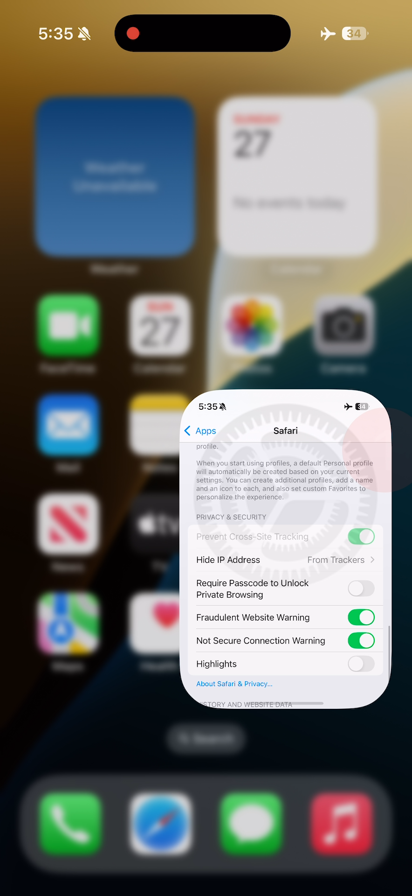

### Notes App Opening Two Status Bars: timestamp 00:03:16.537
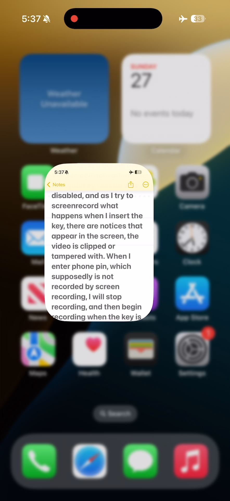

### Notes App Opening Two Status Bars: timestamp 00:00:36.779
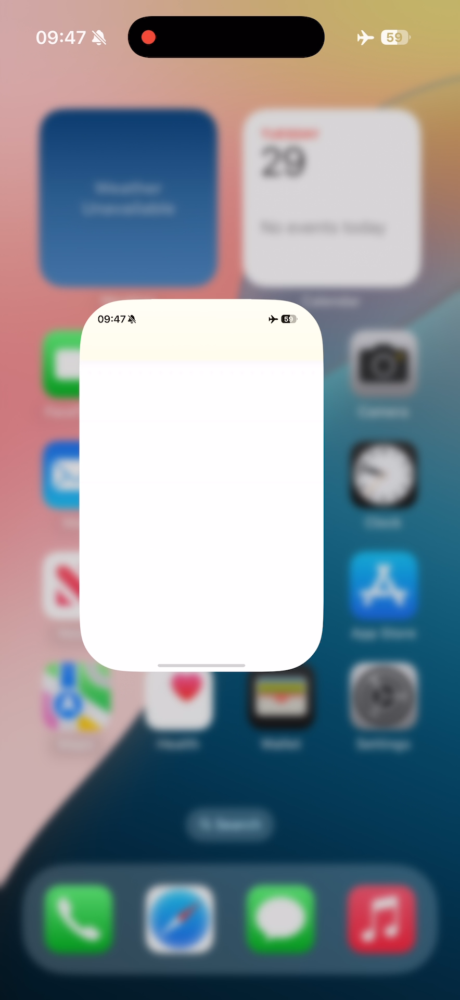
