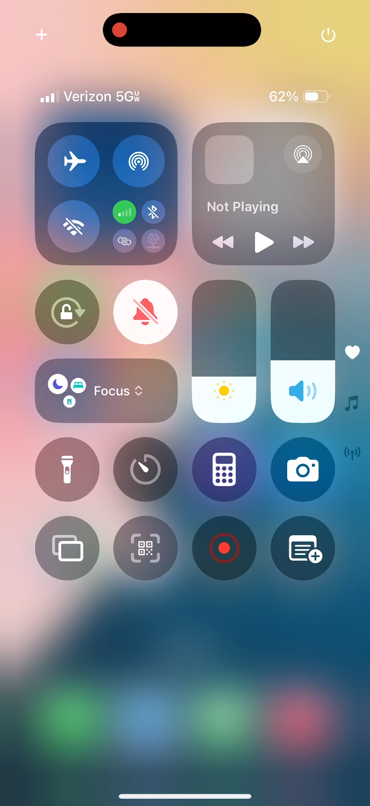
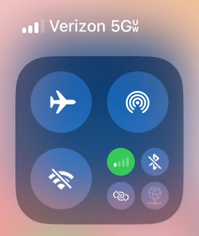
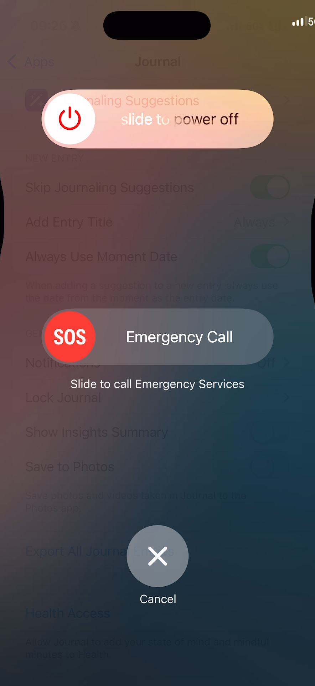
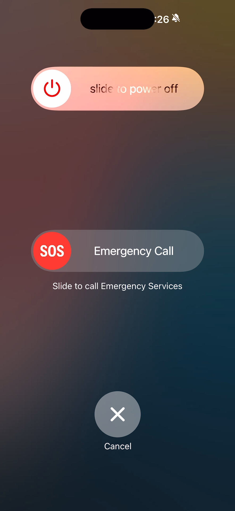

## This screenshot illustrates the anomaly of the Signal Strength discrepancy that appears at the beginning of the screen recording, when the Control Center is still down after the Screen Recording button was tapped.

### Control Center Signal Strength Icons Show a Discrepancy. The Signal Strength to the left of the Verizon network label shows three white active bars and one gray inactive bar. The Signal Strength of the bright green icon inside the connectivity group shows one white active bar and tree gray inactive bars: timestamp 00:00:00.000

### Cutout from the screenshot that zooms into the Control Center Signal Strength Icons. The Signal Strength to the left of the Verizon network label shows three white active bars and one gray inactive bar. The Signal Strength of the bright green icon inside the connectivity group shows one white active bar and tree gray inactive bars: timestamp 00:00:00.000

## These screenshots illustrate the anomaly of the too far to the right status bar when the volume up and power button were pressed to trigger the hard power off interface.

### Too Far to the Right Status Bar Shows Signal Strength and Network Label Icon Passed the Right Edge of the Screen: timestamp 00:01:16.663

### Too Far to the Right Status Bar Shows System Time and Silent Phone Icons Passed the Right End of the Dynamic Island: timestamp 00:01:16.960

