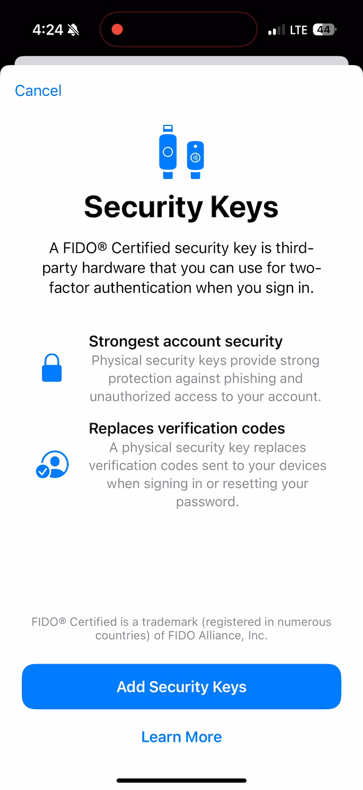
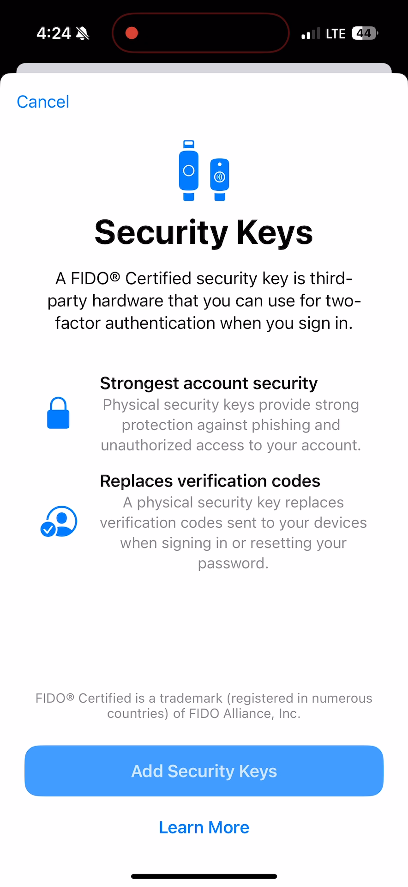
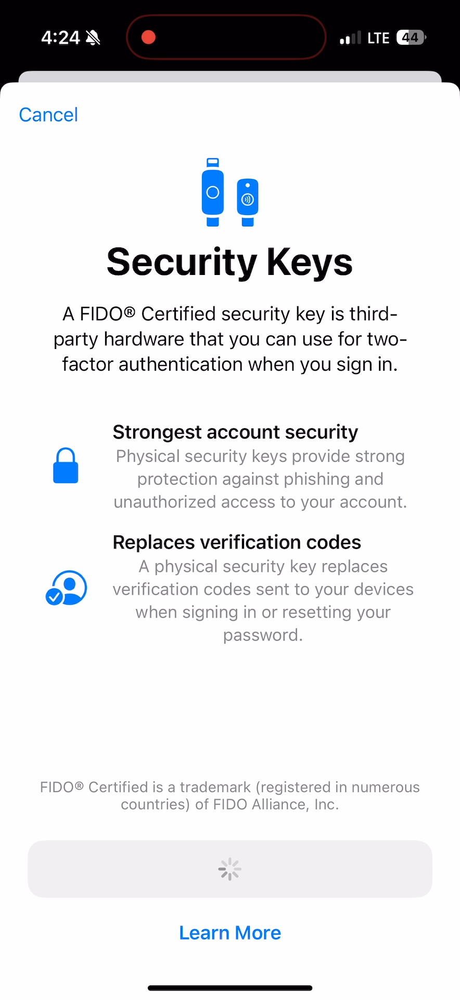
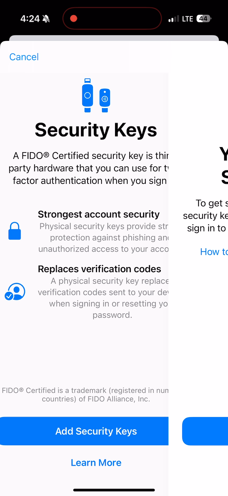

## These screenshots illustrate the behavior of the "Add Security Keys" button of the "Security Keys" interface:

### Add Security Keys Initial State: timestamp 00:01:19.342

### Add Security Keys Tapped: timestamp 00:01:21.652

### Add Security Keys Spinning Wheel: timestamp 00:01:21.751

### Add Security Keys BG Color Back to Initial State: timestamp 00:01:22.444

### Add Security Keys Next Screen: timestamp 00:01:22.477

