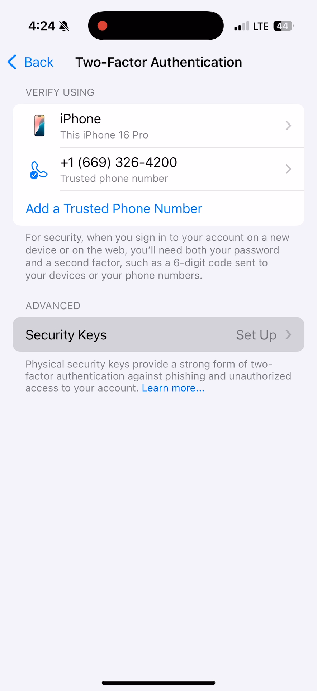
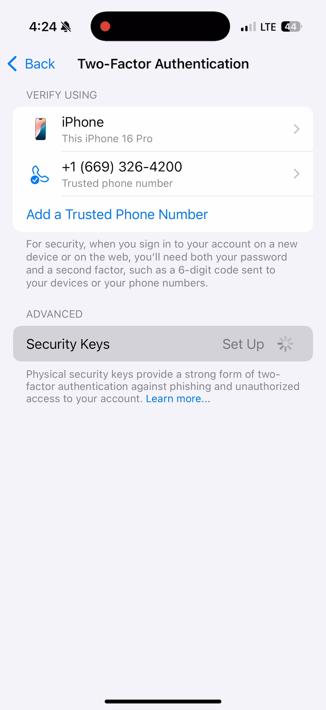
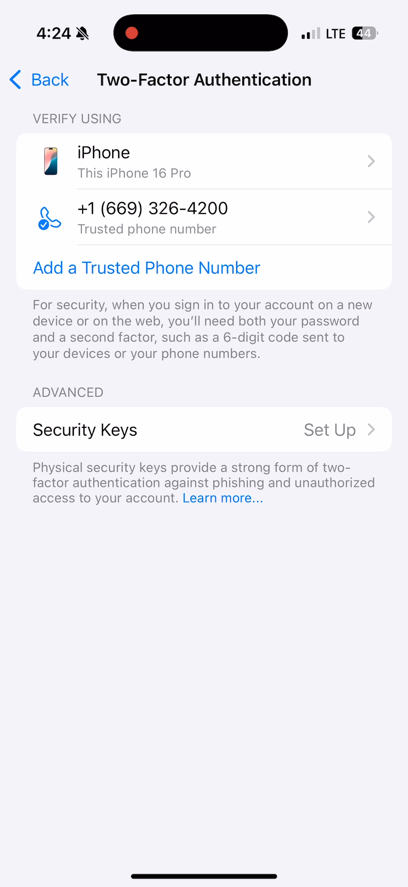
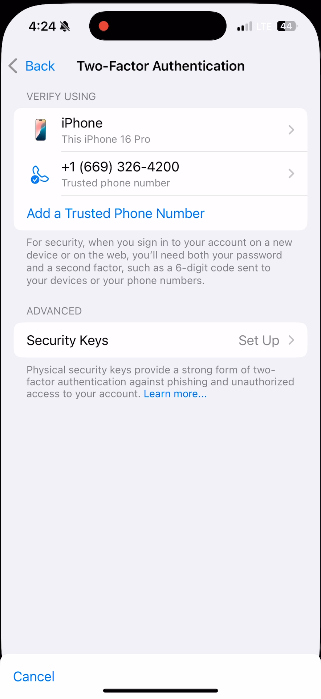

## These screenshots illustrate the behavior of the "Security Keys Set Up" button of the Two-Factor Authentication interface:

### Two-Factor Authentication Security Keys Set Up Initial State: timestamp 00:01:18.121

### Two-Factor Authentication Security Keys Set Up Tapped: timestamp 00:01:18.154

### Two-Factor Authentication Security Keys Set Up Spinning Wheel: timestamp 00:01:18.187

### Two-Factor Authentication Security Keys Set Up BG Color Back to Initial State: timestamp 00:01:18.583

### Two-Factor Authentication Security Keys Set Up Back to Initial State: timestamp 00:01:18.682

### Two-Factor Authentication Security Keys Set Up Next Screen: timestamp 00:01:18.748

