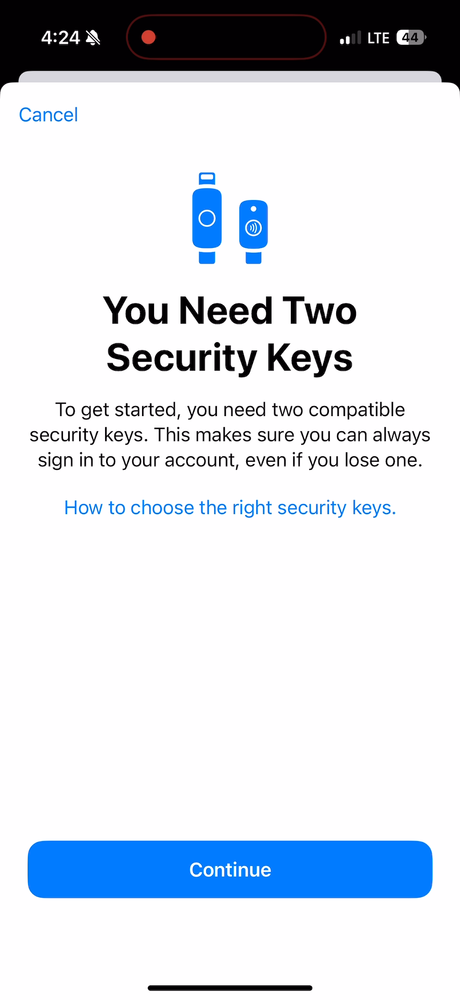
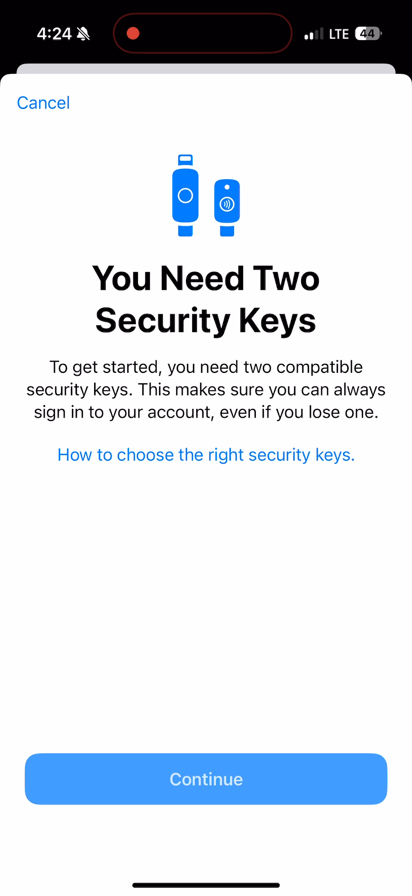
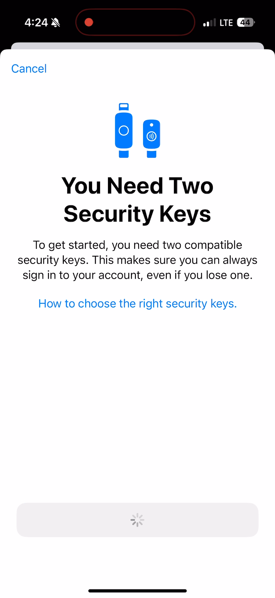
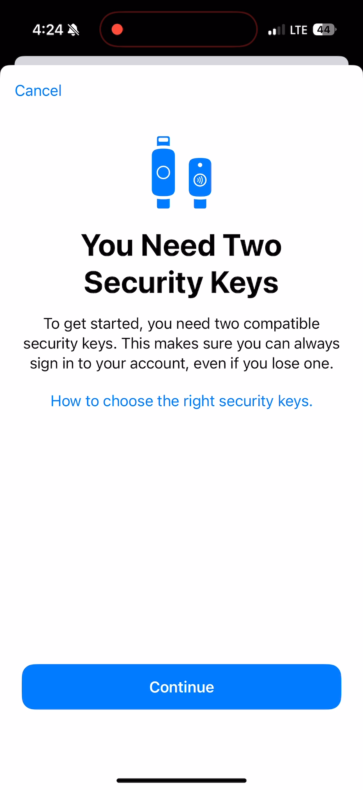
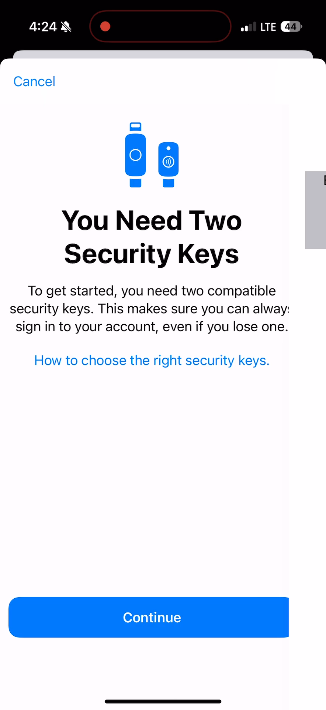

## These screenshots illustrate the behavior of the "Continue" button of the "You Need Two Security Keys" interface:

### You Need Two Security Keys Initial State: timestamp 00:01:23.071

### You Need Two Security Keys Tapped: timestamp 00:01:25.645

### You Need Two Security Keys Spinning Wheel: timestamp 00:01:25.744

### You Need Two Security Keys BG Color Back to Initial State: timestamp 00:01:26.536

### You Need Two Security Keys Next Screen: timestamp 00:01:27.493

